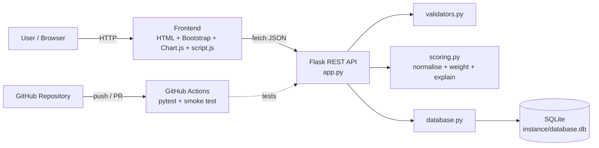
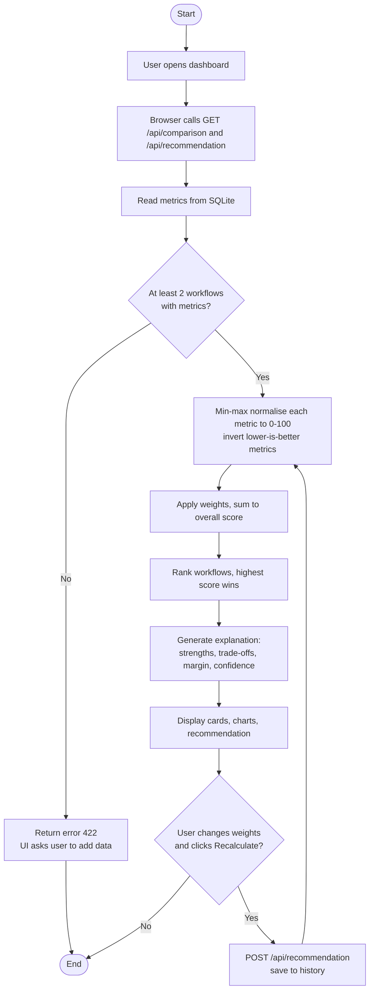
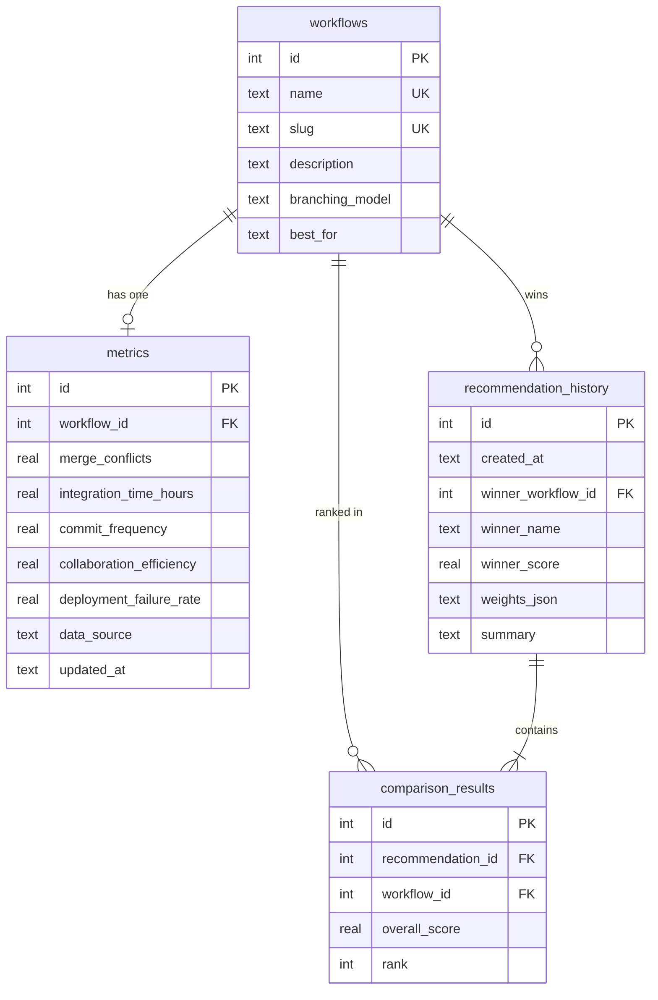

# Intelligent Git Workflow Optimization for Full Stack Development

**A DevOps Mini Project Report**

Submitted by: [Student Name] · Roll/SAP No.: [____] · Course: B.Tech (Computer Science) · Subject: DevOps
Guide: [Faculty Name] · Institution: [College / University] · Academic Year: [____]

> **Data disclaimer:** all workflow metrics used in this project are *simulated sample data* created for demonstration. They are not measurements from real production systems. The value of the project is the comparison *method* (normalisation + weighted scoring), which works on real data once it is entered.

> **How to render diagrams:** the diagrams below are written in Mermaid. They render automatically on GitHub and in VS Code (install the extension *Markdown Preview Mermaid Support*). For Word/PDF, paste each block at https://mermaid.live and export a PNG.

---

## 1. Abstract
Choosing a Git branching workflow is a key DevOps decision, but teams often choose by habit rather than evidence. This project builds a web-based decision-support system that compares three popular workflows, Git Flow, GitHub Flow and Trunk-Based Development, across five parameters: merge conflicts, code integration time, commit frequency, collaboration efficiency and deployment failure rate. A Flask REST API stores the metrics in SQLite and a scoring engine min-max normalises each metric, applies configurable weights and produces an overall score out of 100. The Bootstrap/Chart.js dashboard presents bar and radar charts and a recommendation with a generated explanation. The project also demonstrates DevOps practice itself: Git branching, pull requests, merge-conflict resolution and a GitHub Actions pipeline that runs 52 automated tests on every push and pull request.

## 2. Introduction
DevOps aims to shorten the time from code to production while keeping quality high. Version control is the foundation of that pipeline, and the *branching strategy* decides how often code is integrated, how often conflicts appear and how safely releases are made. As full-stack teams grow, a poor strategy causes long-lived branches, painful merges and unstable releases.

## 3. Problem Statement
Teams lack a simple, transparent way to compare branching workflows using measurable parameters and to see *why* one is recommended for their priorities. Existing explanations are mostly descriptive articles with no quantitative comparison.

## 4. Objectives
1. Compare Git Flow, GitHub Flow and Trunk-Based Development on five parameters.
2. Build a scoring algorithm with normalisation and explainable weights.
3. Provide a REST API with CRUD for metrics and endpoints for comparison, scores and recommendation.
4. Provide an interactive dashboard (bar chart, radar chart, recommendation).
5. Demonstrate Git branching, pull requests, conflict resolution and CI/CD.
6. Verify the logic with automated tests.

## 5. Scope of the Project
**In scope:** three workflows, five metrics, simulated data, editable metrics, adjustable weights, recommendation history, automated tests, CI pipeline.
**Out of scope:** automatic collection of metrics from real repositories, user authentication, multi-team tenancy, production deployment.

## 6. Existing System
Blog posts and documentation (e.g. Atlassian, GitHub Docs, trunkbaseddevelopment.com) describe each workflow qualitatively. Tools such as GitHub Insights or DORA dashboards measure one team's own history but do not compare workflows side by side or recommend one. Decisions are therefore subjective.

## 7. Proposed System
A lightweight web application that stores comparable metrics per workflow, converts them to a common 0-100 scale, applies team-adjustable weights and recommends the highest-scoring workflow with an explanation (strengths, trade-offs, margin, confidence). Every recommendation can be saved to a history table for review.

## 8. Literature / Technology Overview
| Technology | Role in the project |
|---|---|
| Git / GitHub | Version control, branching, pull requests |
| Git Flow (Driessen, 2010) | Long-lived `main` + `develop`, release and hotfix branches |
| GitHub Flow | Single `main`, short feature branches, PR review |
| Trunk-Based Development | Daily integration to one trunk; feature flags |
| DORA metrics (Accelerate, Forsgren et al.) | Motivation: lead time and change-failure rate relate to delivery performance |
| Python Flask | Lightweight web framework and REST API |
| SQLite | Embedded relational database, zero configuration |
| Bootstrap 5 / Chart.js | Responsive UI and charts |
| pytest | Unit and API testing |
| GitHub Actions | CI/CD automation |

## 9. System Architecture

The architecture is a three-tier design: presentation (browser), application logic (Flask + scoring engine) and data (SQLite). The CI pipeline sits outside the runtime and verifies the application on every change.

## 10. Functional Requirements
| ID | Requirement |
|---|---|
| FR1 | Show three workflow cards with description, metrics and score |
| FR2 | Show the best performer for each of the five parameters |
| FR3 | Show a bar chart and a radar chart of normalised scores |
| FR4 | Create, read, update and delete metric records |
| FR5 | Calculate normalised scores and an overall score out of 100 |
| FR6 | Recommend the best workflow and explain why |
| FR7 | Let the user change weights and recalculate |
| FR8 | Save and display recommendation history |
| FR9 | Validate input and return clear JSON errors |
| FR10 | Label all data as simulated |

## 11. Non-Functional Requirements
- **Usability:** single-page dashboard, responsive on laptop and phone widths.
- **Reliability:** input validation, database CHECK constraints, JSON error handling.
- **Performance:** responses in milliseconds for this data size.
- **Maintainability:** separate modules (API, scoring, database, validation), automated tests.
- **Portability:** runs on Windows/Linux/macOS with only Python installed.
- **Security (basic):** parameterised SQL queries, HTML-escaping of database text in the UI. No authentication (see limitations).

## 12. Hardware and Software Requirements
**Hardware:** any PC/laptop, 4 GB RAM (8 GB recommended), 500 MB free disk.
**Software:** Windows 10/11, Python 3.10+, VS Code (with Python extension), Git, a modern browser (Chrome/Edge), internet access for CDN files and GitHub, a GitHub account.

## 13. Module Description
| Module | File | Responsibility |
|---|---|---|
| API / Controller | `app.py` | Routes, JSON responses, error handlers |
| Scoring engine | `scoring.py` | Normalisation, weights, overall score, explanation |
| Validation | `validators.py` | Type and range checks on metric input |
| Data layer | `database.py` | Schema, seed data, CRUD and history functions |
| Frontend | `templates/index.html`, `static/css/style.css`, `static/js/script.js` | Dashboard, charts, forms |
| Tests | `tests/` | Scoring, database, API and frontend-wiring tests |
| DevOps | `.github/workflows/ci.yml`, `scripts/demo_merge_conflict.sh` | CI/CD and Git demonstration |

**Flowchart of the recommendation process**


## 14. Database Design

Design notes: `metrics.workflow_id` is UNIQUE (one current record per workflow); CHECK constraints keep percentages in 0-100; `ON DELETE CASCADE` removes metrics when a workflow is deleted; history stores the weights used so a result can be reproduced.

**Simulated sample data**
| Workflow | Conflicts / month | Integration time (h) | Commits / dev / day | Collaboration (0-100) | Failure % |
|---|---|---|---|---|---|
| Git Flow | 18 | 36 | 2.1 | 72 | 4.8 |
| GitHub Flow | 11 | 14 | 3.4 | 85 | 6.2 |
| Trunk-Based | 6 | 3 | 5.2 | 70 | 7.5 |

The numbers were chosen to reflect common qualitative claims (long-lived branches create more conflicts and slower integration; trunk-based commits are small and frequent; release branches and QA gates in Git Flow reduce deployment failures; GitHub Flow's pull-request review helps collaboration). They are illustrative only.

## 15. Implementation Details
**Scoring algorithm** (`scoring.py`)
1. *Normalisation (min-max):* for "higher is better": `(x - min) / (max - min) x 100`; for "lower is better": `(max - x) / (max - min) x 100`. If all values are equal, all get 100.
2. *Weights* (sum to 100%; user-adjustable and auto-rescaled):

| Metric | Direction | Default weight | Reason |
|---|---|---|---|
| Integration time | lower | 25% | Core CI/CD goal: fast delivery |
| Merge conflicts | lower | 20% | Wasted effort and risk |
| Collaboration efficiency | higher | 20% | Team productivity |
| Deployment failure rate | lower | 20% | Stability |
| Commit frequency | higher | 15% | Indicator of small batches; weaker signal on its own |

3. *Overall score* = sum of (normalised value x weight).
4. *Recommendation* = highest overall score; the explanation lists metrics where the winner is best, metrics where it scores 50 or below, the margin over the runner-up and a confidence label (High ≥ 15 points, Moderate 5-15, Low < 5).

**Worked example (default weights)**
| Metric (weight) | Git Flow | GitHub Flow | Trunk-Based |
|---|---|---|---|
| Conflicts (0.20) | 0 | 58.33 | 100 |
| Integration time (0.25) | 0 | 66.67 | 100 |
| Commit frequency (0.15) | 0 | 41.94 | 100 |
| Collaboration (0.20) | 13.33 | 100 | 0 |
| Failure rate (0.20) | 100 | 48.15 | 0 |
| **Overall** | **22.67** | **64.25** | **60.00** |

GitHub Flow wins by 4.25 points (confidence "Low (close call)"). This matches the hand calculation and the automated test `test_scores_match_hand_calculation`.

**Weight sensitivity.** With speed-focused weights (integration 50, commits 30, conflicts 20) Trunk-Based wins with 100 vs 57.58. With stability-focused weights (failure rate 80, others 5 each) Git Flow wins with 80.67 vs 51.87. This shows the recommendation depends on team priorities and is not hard-coded.

**API.** See the endpoint table in `README.md`. The frontend uses `fetch()` to call `/api/comparison`, `/api/recommendation`, `/api/metrics`, `/api/workflows` and `/api/history`, and `POST /api/recommendation` when weights are recalculated.

**Frontend.** Bootstrap 5 dark theme, two Chart.js charts (bar, radar) built from normalised scores, an edit modal for CRUD, weight sliders, and a history table. All text from the database is HTML-escaped before display.

## 16. Git Workflow Comparison
| Aspect | Git Flow | GitHub Flow | Trunk-Based Development |
|---|---|---|---|
| Main branches | `main` + `develop` | `main` | `main` (trunk) |
| Supporting branches | feature, release, hotfix | feature | very short-lived (< 1 day) or none |
| Integration frequency | Low (at feature/release end) | Medium (per pull request) | Very high (daily or more) |
| Release method | Scheduled via release branch | Deploy from `main` after PR | Continuous, feature flags hide unfinished work |
| Code review | Often at merge to `develop` | Mandatory pull request | Pair/mob programming or fast small reviews |
| Conflict risk | High (long-lived branches) | Medium | Low (tiny changes) |
| Requirements | QA process, release management | Review discipline, CI | Strong automated tests, feature flags, mature CI |
| Best for | Versioned products, scheduled releases | Web apps, SaaS | High-performing continuous-delivery teams |

## 17. Testing and Results
**Test suite:** 52 pytest-style tests in `tests/`: scoring (13), database (9), REST API (24), frontend wiring (6).

| Evidence | Status |
|---|---|
| Hand calculation of scores = test expectation (22.67 / 64.25 / 60.00) | Verified |
| All 52 tests executed, 52 passed | **Verified in the author's build environment** using a minimal stand-in runner because the real `pytest` package could not be installed there (no internet). The tests use only basic pytest features. |
| Real server started and called over HTTP: `/`, static files, `/api/health`, `POST /api/recommendation`, validation error | Verified (build environment) |
| `node --check` on `script.js` | Verified (syntax valid) |
| Git merge-conflict script run end to end | Verified (conflict produced, resolved, graph printed) |
| `ci.yml` parsed as valid YAML | Verified (syntax only) |
| **Running with real pytest on your PC** | **Expected: 52 passed.** Run `python -m pytest -v` and attach your screenshot. |
| **Dashboard rendering in a browser (charts, layout, sliders, modal)** | **Not run by the author (no browser).** Check with the manual checklist in `README.md`. |
| **GitHub Actions run on github.com** | **Not run by the author.** Expected: both jobs green after you push. |

**Sample output (default weights, from the API)**
```
1  GitHub Flow               64.25 / 100
2  Trunk-Based Development   60.00 / 100
3  Git Flow                  22.67 / 100
Winner: GitHub Flow, margin 4.25, confidence Low (close call)
Strength: best Collaboration Efficiency (85/100)
Trade-offs: Commit Frequency scored 42/100, Deployment Failure Rate scored 48/100
```

**Sample output descriptions (for screenshots)**
1. *Dashboard overview:* five cards showing the best value per parameter (Trunk-Based has the lowest conflicts, shortest integration time and highest commit frequency; GitHub Flow the best collaboration; Git Flow the lowest failure rate).
2. *Workflow cards:* three cards with coloured top borders (orange, blue, green), overall score and a green "Recommended" badge on GitHub Flow.
3. *Bar chart:* five groups of three bars on a 0-100 scale; Trunk-Based is tallest on conflicts, integration time and commit frequency; GitHub Flow on collaboration; Git Flow on deployment failure rate.
4. *Radar chart:* Trunk-Based forms a spike on speed-related axes, Git Flow on stability, GitHub Flow is the most balanced shape.
5. *Recommendation panel:* winner, score badge, explanation, confidence and trade-offs, plus score bars.
6. *History table:* each recalculation adds a row with time, winner, score and full ranking.

## 18. Advantages and Limitations
**Advantages:** transparent and explainable scoring; configurable weights; simple stack that runs anywhere; full CRUD; automated tests and CI; also demonstrates Git practices.
**Limitations:**
- Data is simulated; the conclusions are illustrative, not empirical findings.
- Min-max normalisation exaggerates differences with only three workflows (the worst value always becomes 0). The score shows *relative* standing, not absolute quality.
- Five metrics do not capture team size, domain, compliance or culture.
- One metric record per workflow, no per-team or per-time-period data.
- No authentication; not intended for public deployment as-is.
- Metric values are entered manually.

## 19. Future Scope
- Import real metrics from the GitHub REST API (pull-request cycle time, merge conflicts, workflow-run failures).
- Per-team and time-series tracking, with trend charts.
- Other strategies (GitLab Flow, Release Flow) and team-size-based presets.
- Alternative normalisation / multi-criteria methods (TOPSIS, AHP) and sensitivity analysis.
- User login, Docker image and automatic deployment (Render/Azure) as a full CD stage.
- Frontend end-to-end tests (Playwright/Selenium).

## 20. Conclusion
The project delivers a working, explainable tool that turns the qualitative debate about Git workflows into a quantitative comparison. With the simulated data, GitHub Flow offers the best balance, Trunk-Based Development wins when speed is prioritised, and Git Flow wins when stability is prioritised. The recommendation changes with team priorities, which is the main lesson: no workflow is universally best. The project also applies DevOps practice through branching, pull requests, conflict resolution and an automated CI/CD pipeline.

## 21. References
1. V. Driessen, "A successful Git branching model," nvie.com, 2010.
2. GitHub Docs, "GitHub flow," docs.github.com.
3. P. Hammant, "Trunk Based Development," trunkbaseddevelopment.com.
4. N. Forsgren, J. Humble, G. Kim, *Accelerate: The Science of Lean Software and DevOps*, IT Revolution, 2018.
5. S. Chacon and B. Straub, *Pro Git*, 2nd ed., Apress (free at git-scm.com/book).
6. Flask documentation, flask.palletsprojects.com.
7. SQLite documentation, sqlite.org/docs.html.
8. Chart.js documentation, chartjs.org/docs.
9. Bootstrap 5 documentation, getbootstrap.com.
10. pytest documentation, docs.pytest.org.
11. GitHub Docs, "GitHub Actions," docs.github.com/actions.

*Check each reference once (title, year, URL) before final submission and follow your college's citation format.*
